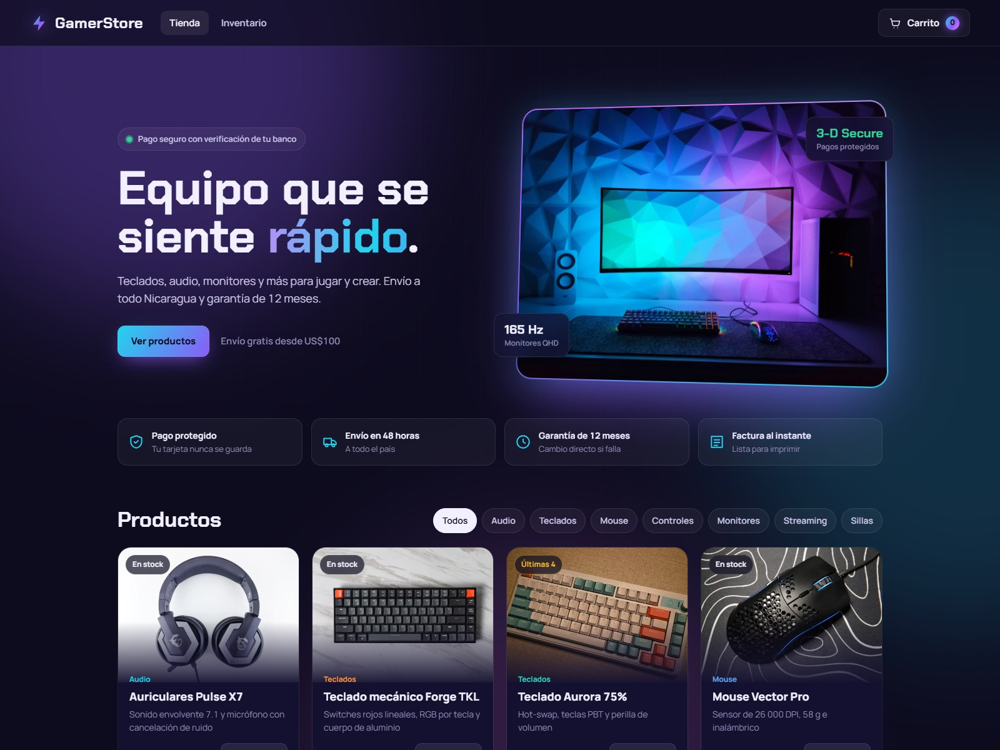
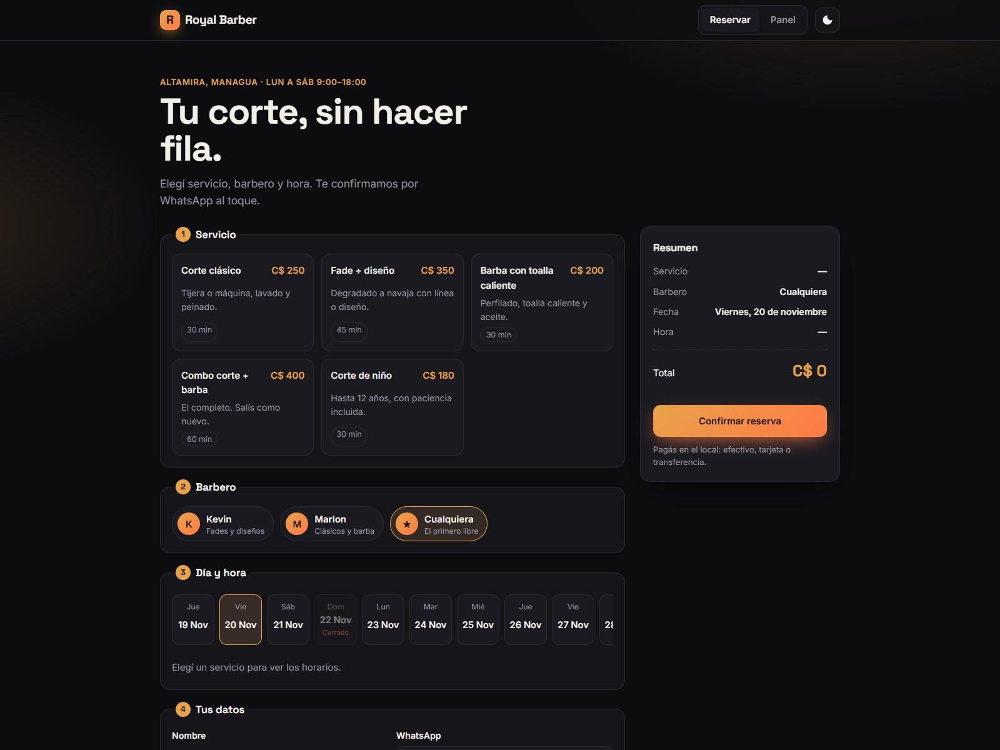
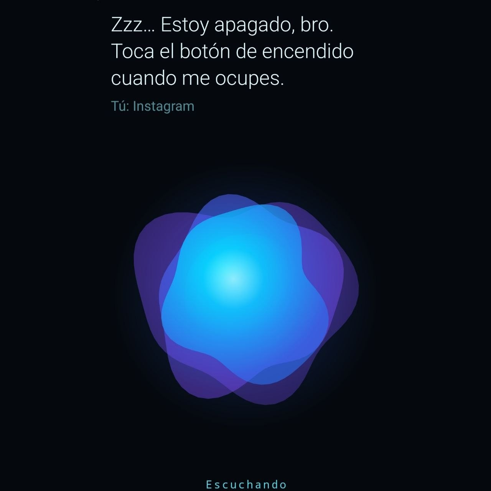
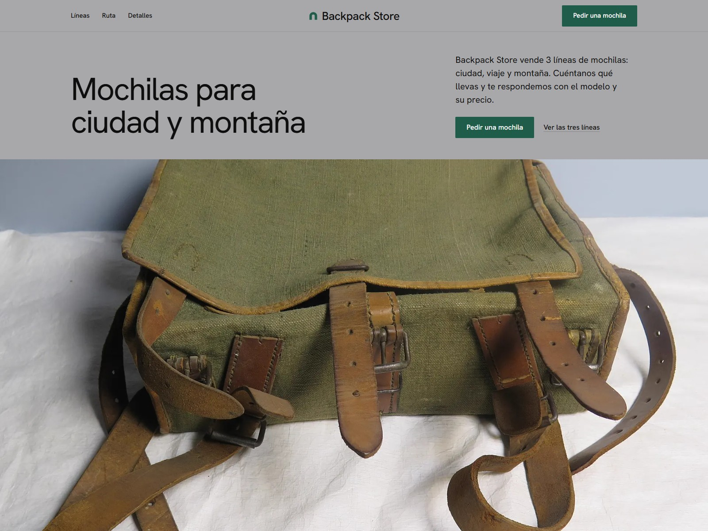
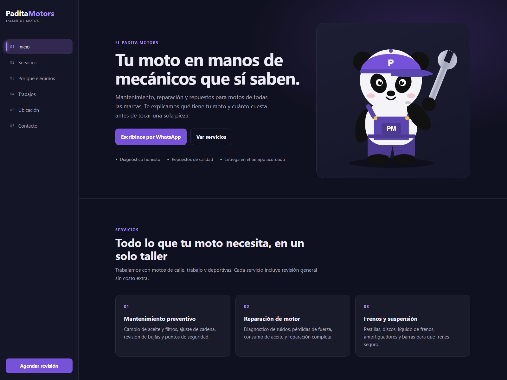

  
  

  

  
  
  
  
  
  

I'm a **full stack developer** from Chinandega, Nicaragua, and a 3rd-year **Systems Engineering** student (UACH). Since 2023 I've built and sold websites for local businesses, handling each project end to end: understanding the client, designing, coding and delivering on time.

- ⚡ I build **online stores with payments**, **booking systems** and **AI-powered apps**
- 🤖 I work with **Claude Code** and APIs like **Stripe** and **Gemini**
- 🎮 Currently learning **game development**
- 💼 **Open to remote jobs and freelance projects**

<table>
  <tr>
    <td width="50%" valign="top">
      
      <h3>🛒 GamerStore</h3>
      Gaming store with a <b>custom Stripe-style payment gateway</b> (tokens, 3-D Secure), inventory and invoices. 
      <code>Python</code> <code>SQLite</code> <code>JavaScript</code> 
      <a href="https://github.com/maltarodrigo5051-blip/tiendas-online/tree/main/gamerstore">Code →</a>
    </td>
    <td width="50%" valign="top">
      
      <h3>💈 Royal Barber</h3>
      Online booking for a barbershop: service, barber and time with no double bookings, plus an admin panel. 
      <code>HTML</code> <code>CSS</code> <code>JavaScript</code> 
      <a href="https://maltarodrigo5051-blip.github.io/paginas-web/royal-barber/">Live demo →</a>
    </td>
  </tr>
  <tr>
    <td width="50%" valign="top">
      
      <h3>🎙️ Josué</h3>
      Hands-free Android voice assistant that talks with <b>Google Gemini AI</b>, on phone and TV. 
      <code>Java</code> <code>Android</code> <code>Gemini API</code> 
      <a href="https://github.com/maltarodrigo5051-blip/sistemas/tree/main/josue-asistente">Code →</a>
    </td>
    <td width="50%" valign="top">
      
      <h3>🎒 Backpack Store</h3>
      Sales landing page for a backpack store, with editorial design and scroll animations. 
      <code>HTML</code> <code>CSS</code> <code>JavaScript</code> 
      <a href="https://maltarodrigo5051-blip.github.io/paginas-web/nubaro/">Live demo →</a>
    </td>
  </tr>
  <tr>
    <td width="50%" valign="top">
      
      <h3>🏍️ Padita Motors</h3>
      Website for a motorcycle repair shop: services, recent work and a booking form. 
      <code>HTML</code> <code>CSS</code> <code>JavaScript</code> 
      <a href="https://maltarodrigo5051-blip.github.io/paginas-web/padita-motors/">Live demo →</a>
    </td>
    <td width="50%" valign="top">
      <h3>🧾 Point of sale</h3>
      Desktop checkout system with <b>barcode scanner</b>, inventory and database. 
      <code>Python</code> <code>SQLite</code> 
      <a href="https://github.com/maltarodrigo5051-blip/sistemas/tree/main/lector-de-codigo-de-barra">Code →</a>
        
      <a href="https://github.com/maltarodrigo5051-blip?tab=repositories"><b>See all my repositories →</b></a>
    </td>
  </tr>
</table>

  

  
  

  

  

