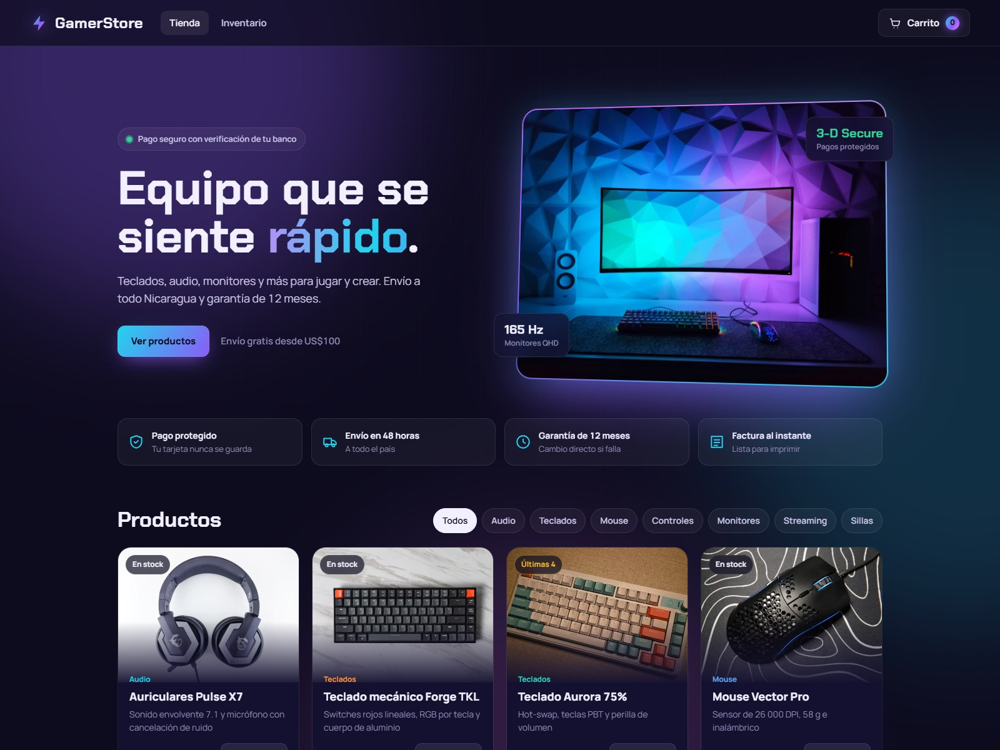
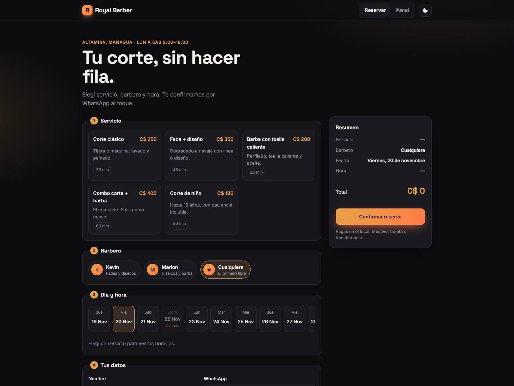
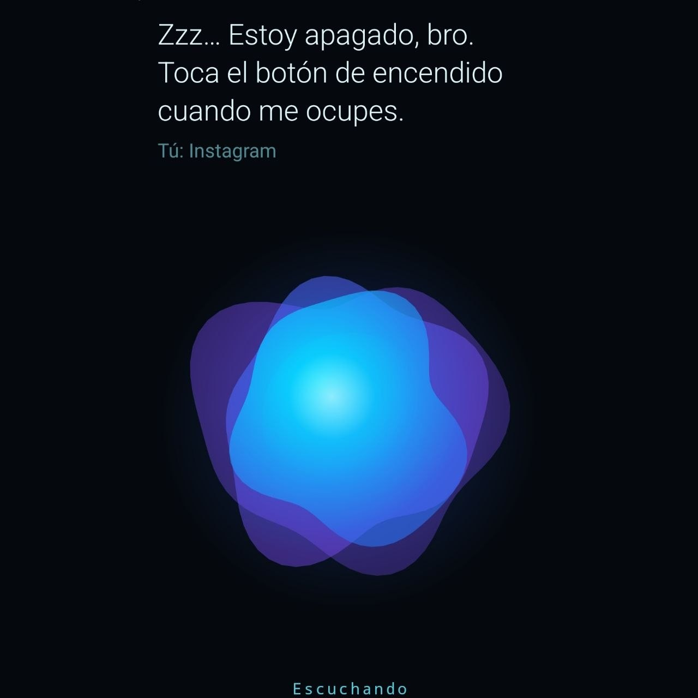
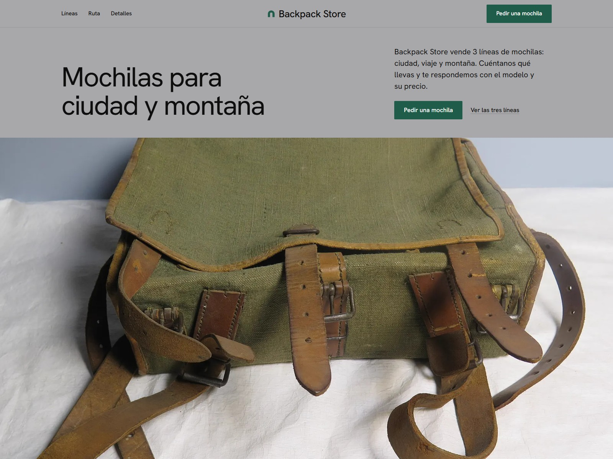
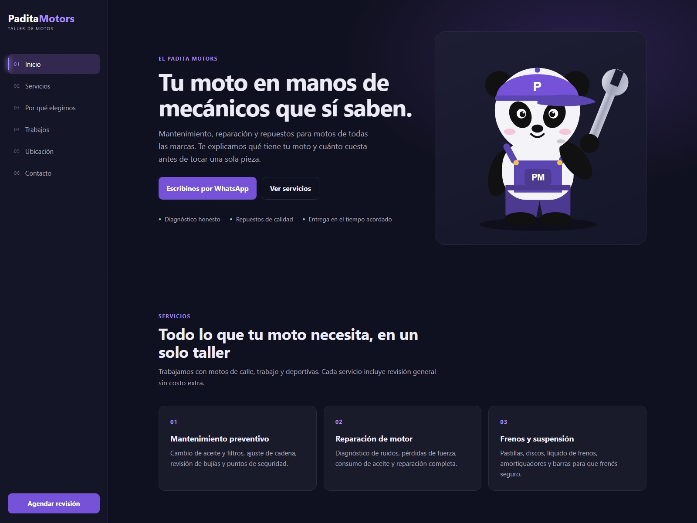

  
  

  

  
  
  
  
  
  

Soy desarrollador **full stack** de Chinandega, Nicaragua, y estudio **Ingeniería en Sistemas** (3.er año, UACH). Desde 2023 hago y vendo sitios web para negocios locales, y llevo cada proyecto de principio a fin: entender al cliente, diseñar, programar y entregar a tiempo.

- ⚡ Construyo **tiendas en línea con pagos**, **sistemas de reservas** y **apps con IA**
- 🤖 Trabajo con **Claude Code** y APIs como **Stripe** y **Gemini**
- 🎮 Ahora estoy aprendiendo a **crear videojuegos**
- 💼 **Busco empleo remoto o proyectos freelance**

<table>
  <tr>
    <td width="33%" align="center" valign="top">
      <h3>🌐 <a href="https://github.com/maltarodrigo5051-blip/paginas-web">Páginas web</a></h3>
      Sitios para negocios con demo en vivo: barbería, mochilas, taller de motos y consolas.
    </td>
    <td width="33%" align="center" valign="top">
      <h3>⚙️ <a href="https://github.com/maltarodrigo5051-blip/sistemas">Sistemas</a></h3>
      Contabilidad, punto de venta, avisos de streams y asistente de voz con IA.
    </td>
    <td width="33%" align="center" valign="top">
      <h3>🛒 <a href="https://github.com/maltarodrigo5051-blip/tiendas-online">Tiendas con pagos</a></h3>
      Tienda en línea con pasarela de pago propia, Stripe, inventario y facturas.
    </td>
  </tr>
</table>

**Destacados:**

<table>
  <tr>
    <td width="50%" valign="top">
      
      <h3>🛒 GamerStore</h3>
      Tienda gaming con <b>pasarela de pago propia estilo Stripe</b> (tokens, 3-D Secure), inventario y facturas. 
      <code>Python</code> <code>SQLite</code> <code>JavaScript</code> 
      <a href="https://github.com/maltarodrigo5051-blip/tiendas-online/tree/main/gamerstore">Código →</a>
    </td>
    <td width="50%" valign="top">
      
      <h3>💈 Royal Barber</h3>
      Reservas en línea para barbería: servicio, barbero y hora sin citas dobles, con panel de administración. 
      <code>HTML</code> <code>CSS</code> <code>JavaScript</code> 
      <a href="https://maltarodrigo5051-blip.github.io/paginas-web/royal-barber/">Demo en vivo →</a>
    </td>
  </tr>
  <tr>
    <td width="50%" valign="top">
      
      <h3>🎙️ Josué</h3>
      Asistente de voz para Android que conversa con la <b>IA de Google Gemini</b>, manos libres, en teléfono y TV. 
      <code>Java</code> <code>Android</code> <code>Gemini API</code> 
      <a href="https://github.com/maltarodrigo5051-blip/sistemas/tree/main/josue-asistente">Código →</a>
    </td>
    <td width="50%" valign="top">
      
      <h3>🎒 Backpack Store</h3>
      Página de ventas para tienda de mochilas, con diseño editorial y animaciones al hacer scroll. 
      <code>HTML</code> <code>CSS</code> <code>JavaScript</code> 
      <a href="https://maltarodrigo5051-blip.github.io/paginas-web/nubaro/">Demo en vivo →</a>
    </td>
  </tr>
  <tr>
    <td width="50%" valign="top">
      
      <h3>🏍️ Padita Motors</h3>
      Sitio para taller de motos: servicios, trabajos recientes y formulario para agendar revisión. 
      <code>HTML</code> <code>CSS</code> <code>JavaScript</code> 
      <a href="https://maltarodrigo5051-blip.github.io/paginas-web/padita-motors/">Demo en vivo →</a>
    </td>
    <td width="50%" valign="top">
      <h3>🧾 Punto de venta</h3>
      Sistema de caja de escritorio con <b>lector de código de barras</b>, inventario y base de datos. 
      <code>Python</code> <code>SQLite</code> 
      <a href="https://github.com/maltarodrigo5051-blip/sistemas/tree/main/lector-de-codigo-de-barra">Código →</a>
        
      <a href="https://github.com/maltarodrigo5051-blip?tab=repositories"><b>Ver todos mis repositorios →</b></a>
    </td>
  </tr>
</table>

  

  
  

  

  

